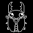
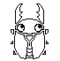
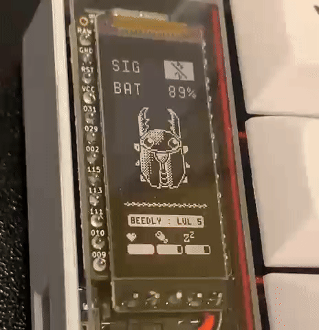

# nice!beetle Fork

This is a forked repo of mctechnology17's fantastic [zmk-nice-oled](https://github.com/mctechnology17/zmk-nice-oled) repo. Please give it a look and some love! None of this would be possible without me plagiarising his code.

This fork changes the gem animation of the nice!oled and nice!epaper to be a Tamagotchi widget of a beetle named Beedly. Why? Because I like beetles and the gem animation wasn't doing it for me.

This fork also provides a guide and (some) tools necessary to display your own images an animation.

See [TODO.md](TODO.md) for planned/future improvements.

# Changing the peripheral animation

The peripheral (right half) shows Beedly by playing the frames in `boards/shields/nice_oled/nice_epaper/assets/beedly_frames.c` with `widgets/animation.c`. The frames are LVGL 9 images in the `LV_COLOR_FORMAT_I1` (indexed 1-bit) format: a 2-colour palette followed by the 1-bit pixel rows. `beedly_frames.c` is generated, so you never edit it by hand, and adding or removing frames needs no change to `animation.c`: the frame table and count are generated too.

## Change Animation with Aseprite and Make commands

Within `./sprite_assets/ase` are the `.aseprite` files for the regular (`beedly_ui`) and dithered (`beedly_ui_dithered`) Beedly animations. If you have [Aseprite](https://www.aseprite.org/), you can modify these and add or remove frames as you please. Draw in opaque black on a transparent background (any transparent or light pixel is background).

Then run one of these from the repo root (Git Bash, or PowerShell with MSYS2's make, e.g. `C:\msys64\usr\bin\make.exe beedly`):

| Command | What it does |
| --- | --- |
| `make beedly` | Exports `beedly_ui.aseprite` with Aseprite and regenerates `beedly_frames.c` |
| `make beedly_dithered` | Same for `beedly_ui_dithered.aseprite` |
| `make beedly_all` | Exports both |
| `make beedly NO_ASEPRITE=1` | Skips Aseprite and regenerates `beedly_frames.c` from the PNGs already in `sprite_assets/renders` (handy if you edit the PNGs directly) |

Aseprite is expected at `C:\Program Files\Aseprite\Aseprite.exe`; pass `ASEPRITE="C:/path/to/Aseprite.exe"` (or set the `ASEPRITE` environment variable) if yours lives elsewhere. Each export replaces `sprite_assets/renders/<name>/frame_<n>.png` (rotated 90 degrees clockwise to the 115x68 orientation the screen shows), and every target then rebuilds `beedly_frames.c` from **both** render folders. That file holds both variants (picked by `CONFIG_NICE_BEETLE_DITHER_BEEDLY`) and the palette switch for `CONFIG_NICE_VIEW_WIDGET_INVERTED`. The output is deterministic, with one pixel row per line plus an ASCII preview, so `git diff` shows exactly what changed. There is nothing to copy by hand.

Commit `beedly_frames.c` (and the `.aseprite`/PNG files), push, and rebuild your firmware. To preview the animation on your PC before flashing, use the simulator (see below, and the animation workflow in [sim/README.md](sim/README.md)).

## Change Animation With Other Tools

You can use any PNG instead. Either:

- Save your frames as `sprite_assets/renders/beedly_ui/frame_0.png`, `frame_1.png`, ... (115x68, opaque black on transparent; `beedly_ui_dithered` for the dithered variant) and run `make beedly NO_ASEPRITE=1`; or
- Convert an image with the [LVGL image converter](https://lvgl.io/tools/imageconverter): select **LVGL v9**, colour format **I1** (indexed 1-bit) and C array output. In your own asset file, keep the converter's `lv_image_dsc_t` (`.header.magic = LV_IMAGE_HEADER_MAGIC`, `.header.cf = LV_COLOR_FORMAT_I1`, `.header.w`, `.header.h`, `.header.stride = (w + 7) / 8`, `.data_size`, `.data`) and its pixel bytes (everything after the two 4-byte palette entries at the top of the `..._map[]` array), but replace those two palette entries with the firmware's palette: `BEEDLY_PALETTE` in `beedly_frames.c`, or the `#if CONFIG_NICE_VIEW_WIDGET_INVERTED` palette lines used in the other asset files, so the image follows the inverted setting. `python sprite_assets/convert_to_lvgl.py <png or folder>` produces the same kind of C file locally.

# Changing the central (left half) animation

The central screen shows a smaller Beedly where the original nice!oled showed the Luna dog. It comes from `sprite_assets/ase/beedly_left.aseprite` (32x32, drawn light on a dark `bg` layer; the light pixels are Beedly, drawn in the screen's text colour on a transparent background, so it also works with `CONFIG_NICE_VIEW_WIDGET_INVERTED`). Every animation is an Aseprite **tag**, and the firmware picks one:

| Tag | Shown when |
| --- | --- |
| `Idle` | below 15 WPM, and while Gui/Super is held (there is no Gui tag) |
| `Walk` | 15 to 69 WPM |
| `Sprint` | 70 WPM and above |
| `Shift` / `Ctrl` / `Alt` | that modifier is held |
| `CAPSLOCK` | Caps Lock is on (Num Lock and Scroll Lock show nothing) |

When several apply, the first of Gui, Alt, Ctrl, Shift, Caps Lock wins (the old Luna priority), otherwise the WPM animation plays. Releasing the keys returns to the WPM animation. Thresholds and frame times are Kconfig options in `boards/shields/nice_oled/nice_epaper/Kconfig.defconfig` (`CONFIG_NICE_BEETLE_LUNA_WALK_WPM`, `..._SPRINT_WPM`, `..._IDLE_FRAME_MS`, `..._WALK_FRAME_MS`, `..._SPRINT_FRAME_MS`). The modifier and Caps Lock speeds still use `CONFIG_NICE_OLED_WIDGET_MODIFIERS_INDICATORS_LUNA_ANIMATION_MS` and `CONFIG_NICE_OLED_WIDGET_HID_INDICATORS_LUNA_ANIMATION_MS`, which give the time for two frames.

Edit the file in Aseprite. You can add frames to a tag or move tag ranges, but keep the seven tag names. Then run:

| Command | What it does |
| --- | --- |
| `make beedly_left` | Exports `beedly_left.aseprite` (frames + tag list) to `sprite_assets/renders/beedly_left/` and regenerates `assets/beedly_luna_frames.c` and `.h` |
| `make beedly_left NO_ASEPRITE=1` | Regenerates them from the PNGs and `tags.json` already there |
| `make beedly_all` | Also runs `beedly_left` |

A missing tag stops the export with an error that lists the tags found. Frame counts are generated, so the C code never needs editing. Preview with `make sim`, or keep `make sim-watch` open, which re-exports and reloads when you save the `.aseprite` file. `make sim-test` checks every animation frame by frame (see [sim/README.md](sim/README.md#central-beedly-left-half-replaces-the-luna-dog)).

Make sure your keymap repo's `west.yml` points to this repo (instead of zmk-nice-oled) and the corresponding branch, and you're good to go.

# Simulator (preview screens on your PC)

`make sim` builds and opens a Windows simulator of both halves' nice!view screens (central on the left, peripheral on the right) driven by the real widget code and ZMK's keymap/behaviour engine, built against the same ZMK `main` and LVGL 9 as the firmware, using the [alphred_kb](https://github.com/J-Jaywalker/alphred_kb) Corne keymap (override with `KEYMAP=...`). Press keys with your PC keyboard or by clicking the on-screen Corne, and change battery, USB/charging, BLE, split link and caps lock from the window. `make sim-test` runs a scripted headless check that writes PNG/GIF output.

It needs MSYS2 (`make sim-deps` installs the 32-bit gcc and SDL2 packages) and Python 3 with pyyaml. Timing is approximate (CPU time is not modelled, BLE/USB/split are behavioural models, deep sleep is not active). See [sim/README.md](sim/README.md) for controls, the script format, the accuracy report and the workflow for iterating on the Beedly animation.

# Future Improvements
See the details in [TODO.md](TODO.md).

